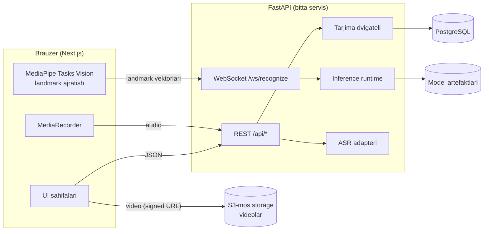
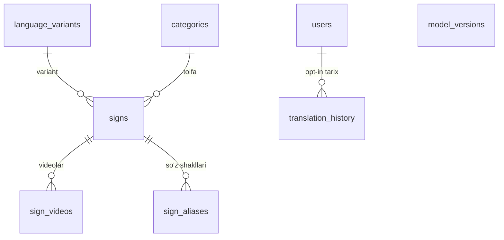

# UzSign AI — Arxitektura chizmasi

Hujjat versiyasi: 0.1 (1-bosqich). Yangi bosqichlar qo'shilishi bilan yangilanadi.

## 1. Talablar tahlili

### 1.1 Haqiqiy ma'lumot talab qiladigan funksiyalar

| Funksiya | Nima kerak | Hozirgi holat |
|---|---|---|
| Matndan imo-ishoraga | Mutaxassis tasdiqlagan imo-ishora videolari + o'zbekcha so'z shakllari (alias) | **Yo'q.** Kod tayyorlanadi, kontent kerak |
| Lug'at | Xuddi shu tasdiqlangan yozuvlar | **Yo'q** |
| Imo-ishoradan matnga | Rozilik berilgan ko'p ishtirokchili video to'plam (~50 sinf), o'qitilgan model | **Yo'q.** Pipeline yoziladi, model o'qitilmagan |
| Nutqdan imo-ishoraga | O'zbek tilini yaxshi taniydigan ASR modeli / API | **Yo'q.** Provayder tanlanishi kerak |
| Imo-ishora tili varianti | Jamoatchilik tasdiqlagan, aniq nomlangan variant | **Ochiq savol** (8-bo'limga qarang) |

Xulosa: dasturiy ta'minot to'liq quriladi, ammo ma'lumotga bog'liq har bir
funksiya ma'lumot ulangunga qadar aniq **"sozlanmagan / mavjud emas"** holatini ko'rsatadi.
Soxta bashorat, o'ylab topilgan imo-ishora yoki metrikalar ishlatilmaydi.

### 1.2 Tarjima darajalari (aniq ajratiladi)

1. **Lug'atga asoslangan tarjima** — so'z/ibora → tasdiqlangan imo-ishora videosi. *MVP.*
2. **Alohida imo-ishorani aniqlash** — bitta imo-ishora videosi → bitta gloss. *MVP (model bo'lsa).*
3. **Uzluksiz aniqlash** — imo-ishoralar oqimi → gloss ketma-ketligi. *Kelajak.*
4. **Gap darajasidagi tarjima** — grammatikani hisobga oluvchi tarjima. *Kelajak, lingvist ekspertlar bilan.*

## 2. MVP doirasi (aniq)

**Kiradi:**
- Matn → imo-ishora: normalizatsiya (o'zbek apostrof variantlari: `'` `’` `‘` `ʻ` `ʼ` → yagona belgi),
  tokenizatsiya, eng uzun ibora bo'yicha alias qidiruvi, video ketma-ketligi, topilmagan so'zlarni ko'rsatish.
- Ketma-ket video pleyer: pauza, davom, qayta ijro, tezlik, gloss belgilari, matnli ekvivalent.
- Lug'at: qidiruv, toifa filtri, alifbo bo'yicha ko'rish, batafsil sahifa. Faqat `verified` yozuvlar.
- Kamera sahifasi: ruxsat oqimi, MediaPipe Hand/Pose landmarklari (brauzerda), overlay,
  chegaralangan ketma-ketlik buferi, WebSocket orqali bashorat, ishonch chegarasi, silliqlash,
  "Noma'lum imo-ishora" holati; model yo'q bo'lsa "Model sozlanmagan".
- ML pipeline: manifest validatsiyasi → landmark ajratish → normalizatsiya → ishtirokchi bo'yicha bo'linish →
  Random Forest baseline → GRU → baholash → versiyalangan checkpoint → backend inference.
- Nutq: mikrofon ruxsati, yozib olish holati, sozlanadigan ASR adapteri, tahrirlanadigan transkripsiya.
- Admin: autentifikatsiya, RBAC (`admin`, `editor`), yozuvlarni boshqarish, video yuklash, tasdiqlash, model versiyalari.

**Kirmaydi (MVP dan keyin):** uzluksiz aniqlash, gap darajasidagi tarjima, avatar animatsiyasi,
foydalanuvchi ro'yxatdan o'tishi (faqat admin/editor hisoblari), mobil ilova.

## 3. Tizim arxitekturasi



Asosiy qarorlar:

- **Modulli monolit (FastAPI).** Mikroservislar uchun hozircha asos yo'q. Inference modul sifatida
  ajratilgan, kerak bo'lsa keyinchalik alohida servisga chiqariladi.
- **Landmarklar brauzerda ajratiladi.** Serverga xom video yuborilmaydi — bu maxfiylik
  (yuz tasviri chiqmaydi), trafik (kadr o'rniga ~1.5 KB vektor) va server yuki uchun yaxshiroq.
  Server faqat raqamli koordinatalarni qabul qiladi.
- **Videolar S3-mos storage'da**, DB faqat `storage_key` saqlaydi. Brauzer videoni to'g'ridan-to'g'ri oladi.
- **Imkoniyat holati serverdan.** `/api/models/status` model ro'yxatga olingan, artefakt mavjud va
  inference runtime ishlay olishini tekshiradi. Frontend "tayyor" deb faqat shunda ko'rsatadi.
- **Tarjima dvigateli interfeys orqali** (`Translator` protokoli): MVP da `DictionaryTranslator`,
  kelajakda grammatikani hisobga oluvchi implementatsiya almashtiriladi.

## 4. Texnologiyalar va versiyalar

| Qatlam | Tanlov | Izoh |
|---|---|---|
| Frontend | Next.js 16.4 (App Router), React 19.3, TypeScript 5 (strict + `noUncheckedIndexedAccess`) | Next 16 da `cacheComponents` va `partialPrefetching` standart yoqilgan |
| Stil | Tailwind CSS 4, shadcn/ui uslubidagi komponentlar (cva, tailwind-merge, Radix Slot) | shadcn CLI muhit tarmog'ida bloklangan edi; komponentlar shadcn konventsiyasi bo'yicha qo'lda yozildi — natija bir xil (manba kod repoda) |
| Ma'lumot olish | TanStack Query 5, Zod 4 | Barcha API javoblari runtime'da Zod bilan tekshiriladi |
| Mavzu | Inline pre-paint script + `useSyncExternalStore` | `next-themes` kerak emas; Next rasmiy hujjatidagi usul, miltillash yo'q |
| Testlar (FE) | Vitest 5, Testing Library, jsdom | |
| Backend | Python 3.12+, FastAPI 0.162, Pydantic 2, SQLAlchemy 2.1 (async), asyncpg, Alembic 1.20 | Docker image Python 3.12 (PyTorch/MediaPipe mosligi uchun) |
| Sifat | ruff, mypy `--strict`, pytest (haqiqiy PostgreSQL bilan) | |
| CV | `@mediapipe/tasks-vision` (brauzer), `mediapipe` (Python, dataset uchun) | Faqat kamera sahifasida lazy-load |
| ML | NumPy, scikit-learn, PyTorch (GRU/LSTM) | `ml/` alohida muhitda, backendga og'ir bog'liqlik qo'shmaydi |
| Infra | Docker, Docker Compose, GitHub Actions | Redis hozircha kerak emas |

## 5. Ma'lumotlar bazasi



| Jadval | Muhim cheklovlar |
|---|---|
| `users` | `email` unikal va kichik harfda (CHECK), `role ∈ {user, editor, admin}`, `history_opt_in` standart `false` |
| `language_variants` | `code` unikal; `is_test_data` — test variantlari ommaga ko'rsatilmaydi |
| `categories` | `name`, `slug` unikal; slug formati CHECK |
| `signs` | `(language_variant_id, gloss)` unikal; `verification_status ∈ {draft, pending_review, verified, rejected, disabled}`; `is_test_data` |
| `sign_aliases` | `(language_variant_id, normalized_text)` unikal → deterministik qidiruv; kompozit FK `(sign_id, language_variant_id)` alias varianti imo-ishora variantiga teng bo'lishini kafolatlaydi |
| `sign_videos` | `storage_key` unikal; `duration_ms > 0`; format `mp4/webm`; har bir imo-ishora uchun bittadan ko'p bo'lmagan asosiy video (partial unique index) |
| `translation_history` | Faqat opt-in; `expires_at` (saqlash muddati) + indeks; xom audio/video saqlanmaydi |
| `model_versions` | `(model_name, model_version)` unikal; har bir vazifa uchun faqat bitta `active` model (partial unique index); metrikalar faqat baholash pipelineidan |

Enumlar `VARCHAR + CHECK` sifatida saqlanadi (native PG enum emas) — yangi qiymat qo'shish oddiy migratsiya.
Barcha cheklov nomlari deterministik (naming convention), migratsiyalar `alembic check` bilan CIda tekshiriladi.

## 6. Repozitoriy tuzilmasi

```
uzsign-ai/
├── frontend/              Next.js ilova
│   ├── app/               Marshrutlar (App Router), layout, providers
│   ├── components/        ui/ (primitivlar), layout/, theme/
│   ├── features/          Funksiya bo'yicha modullar (home/, translate/, recognize/ ...)
│   ├── hooks/             TanStack Query hooklari
│   ├── lib/               env, site-config, theme, utils
│   ├── services/          API klient va endpoint funksiyalari
│   ├── types/             Zod sxemalari + turlari
│   └── tests/             Vitest testlari
├── backend/
│   ├── app/
│   │   ├── api/           Routerlar va dependencylar
│   │   ├── core/          config, errors, logging, middleware
│   │   ├── db/            Base, session
│   │   ├── models/        SQLAlchemy modellari
│   │   ├── schemas/       Pydantic sxemalari
│   │   ├── services/      Biznes mantiq
│   │   ├── scripts/       seed va boshqaruv skriptlari
│   │   └── main.py        App factory
│   ├── alembic/           Migratsiyalar
│   └── tests/             pytest
├── ml/                    datasets, preprocessing, training, inference, evaluation, checkpoints
├── infrastructure/        Deploy konfiguratsiyalari (10-bosqich)
├── docs/                  Hujjatlar
├── .github/workflows/     CI
├── docker-compose.yml
└── .env.example
```

## 7. Rivojlanish yo'l xaritasi

| Bosqich | Mazmun | Holat |
|---|---|---|
| 1 | Arxitektura, sozlash, DB sxemasi, Docker, CI | ✅ Bajarildi |
| 2 | Dizayn tizimi, kontent sahifalari, Sozlamalar, mobil navigatsiya, accessibility | ✅ Bajarildi |
| 3 | Lug‘at API (`/api/signs`) + lug‘at va batafsil sahifalari | Keyingi |
| 4 | Matn → imo-ishora dvigateli, tarjima sahifasi, video pleyer, S3 storage | |
| 5 | Kamera, MediaPipe, overlay, buferlash, WebSocket | |
| 6 | Dataset vositalari, baseline + GRU, baholash, inference | Ma'lumot talab qiladi |
| 7 | Mikrofon, ASR adapteri | ASR provayderi talab qiladi |
| 8 | Admin autentifikatsiya, RBAC, CRUD, video yuklash | |
| 9 | E2E testlar, accessibility audit, performance | |
| 10 | Production deploy, monitoring, hujjatlar | |

## 8. Ochiq savollar (lingvistik to'g'rilik uchun muhim)

1. **Qaysi imo-ishora tili varianti?** O'zbekistonda ishlatiladigan variantni kim tasdiqlaydi
   (masalan, kar va eshitishda nuqsoni bo'lganlar jamiyati, ixtisoslashgan maktablar, sertifikatlangan tarjimonlar)?
2. **Video kontent manbasi va litsenziyasi** — kim yozib oladi, kim tasdiqlaydi, qanday litsenziya ostida?
3. **ASR provayderi** — mahalliy model (masalan, o'zbek tiliga fine-tune qilingan) yoki tashqi API?
   Tanlovdan oldin o'zbek nutqida WER o'lchanadi.
